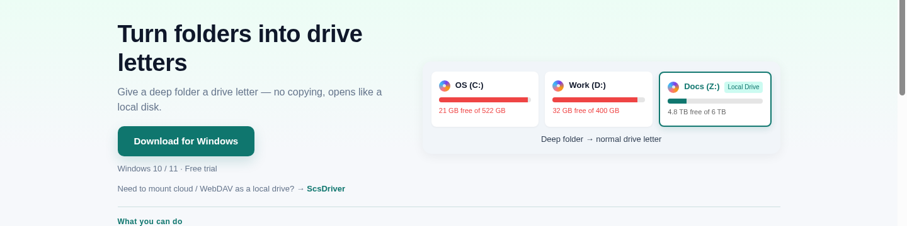
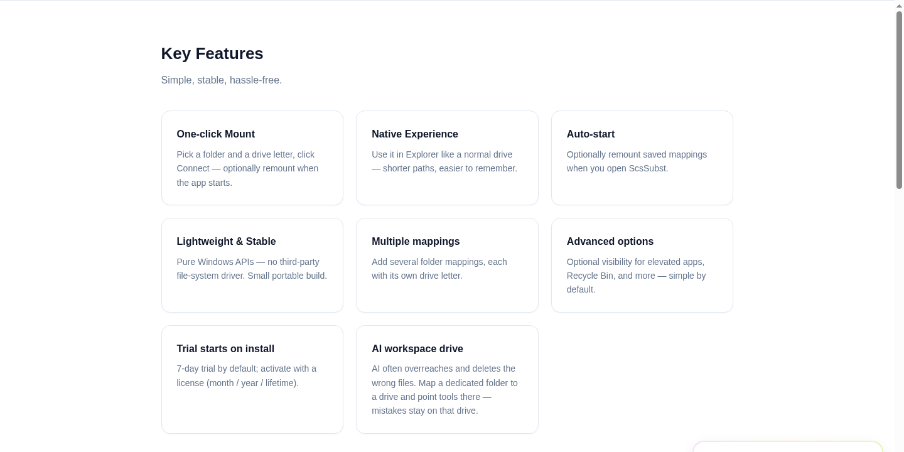

**English** · [中文](README.zh-CN.md) · [日本語](README.ja.md) · [한국어](README.ko.md) · [Español](README.es.md) · [Français](README.fr.md) · [Deutsch](README.de.md) · [Русский](README.ru.md)

  

<h1 align="center">ScsSubst</h1>

  <strong>Turn folders into drive letters</strong> 
  Give a deep folder a drive letter — no copying, opens like a local disk. 
  Official site: <a href="https://subst.scsoi.com">https://subst.scsoi.com</a>

  
  
  
  

  <a href="https://subst.scsoi.com/#download"><strong>Download</strong></a> ·
  <a href="https://subst.scsoi.com/#pricing"><strong>Pricing</strong></a> ·
  <a href="https://subst.scsoi.com/faq"><strong>FAQ</strong></a> ·
  <a href="https://subst.scsoi.com/compare/visual-subst-alternative"><strong>vs Visual Subst</strong></a> ·
  <a href="https://subst.scsoi.com/guide/subst-drive-letter"><strong>Guide</strong></a> ·
  <a href="https://github.com/shuyingegit/scssubst/releases"><strong>Releases</strong></a> ·
  <a href="https://drive.scsoi.com"><strong>ScsDrive</strong></a> ·
  <a href="https://expand.scsoi.com"><strong>ScsExpand</strong></a>

---

## Why ScsSubst?

Give a deep folder a drive letter — no copying, opens like a local disk.

Running tools that can write or delete files — worried they’ll touch the wrong place? Give them a drive they can’t leave.

  

## What you can do

- Everyday folders → drive letters
- Keep tools on one drive — no overreach
- Shorten long project paths
- One drive per workspace

### Spotlight: safer sandboxed workspace

**Give it a drive it can’t leave**

When software can write or delete broadly, the risk is overreach. Map a workspace folder to a drive and keep the tool on it.

1. Create a dedicated workspace folder
2. Map to a drive letter (e.g. Z:)
3. Point the tool workspace to Z:

> Requires the tool workspace on that drive. Practical drive-boundary isolation, not a kernel sandbox.

  

## Key Features

Simple, stable, hassle-free.

- **One-click Mount** — Pick a folder and a drive letter, click Connect — optionally remount when the app starts.
- **Native Experience** — Use it in Explorer like a normal drive — shorter paths, easier to remember.
- **Auto-start** — Optionally remount saved mappings when you open ScsSubst.
- **Lightweight & Stable** — Pure Windows APIs — no third-party file-system driver. Small portable build.
- **Multiple mappings** — Add several folder mappings, each with its own drive letter.
- **Advanced options** — Optional visibility for elevated apps, Recycle Bin, and more — simple by default.
- **Trial starts on install** — 7-day trial by default; activate with a license (month / year / lifetime).
- **Sandbox workspace drive** — Tools that write broadly can delete the wrong files. Map a dedicated folder to a drive and point tools there — mistakes stay on that drive.

## What ScsSubst Is NOT

- **Not a network-drive or WebDAV mounting tool.** ScsSubst maps folders that **already exist on your PC** to a drive letter. It cannot mount a NAS, a mapped share, or cloud storage — that is ScsDrive: https://drive.scsoi.com/
- **Not ScsDrive.** The two are opposites: ScsDrive mounts *remote* storage as a real local disk; ScsSubst maps a *local* folder to a drive letter.
- **Not a file copy or sync tool.** Nothing is copied. ScsSubst creates a mapping that points at the folder where it already sits, so no extra disk space is used and read/write speed stays the same as the disk the folder lives on.
- **Not an OS-level sandbox.** The isolation is practical and drive-boundary based: it works when the tool's workspace is set to that drive letter. It does not raise the Windows MAX_PATH limit on its own either.

## ScsSubst vs. subst.exe, Visual Subst, psubst and mklink /J

The details below reflect each tool's publicly documented behaviour and the current public information on each vendor's own site; please confirm the current state of every product on its official site. Each of these tools is a reasonable choice for its own scenario — the difference is scope.

| Tool | What it is | Gives a drive letter? | After logoff / restart | Where it fits |
|---|---|---|---|---|
| **Windows `subst.exe`** | Command-line tool built into Windows; creates a drive-letter mapping for a local folder | Yes | No — the mapping is session-level and ends at logoff or restart; making it permanent requires your own startup script | The mechanism everything else builds on; also the quickest option for a one-off mapping |
| **Visual Subst** | Free graphical front-end for `subst.exe`; keeps its mapping list in an ini file | Yes | Yes — it can re-create the mappings from the ini file at startup | One-purpose folder-to-letter mapping at logon. Its feature scope is narrower than ScsSubst's, which centres on multiple-mapping management, remount on app start and workspace isolation |
| **psubst** | Command-line tool for creating drive-letter mappings | Yes | With its `/P` switch, which persists the mapping | Scripting and batch workflows; no GUI |
| **vSubst** | Very small graphical front-end for drive-letter mappings | Yes | See the tool's own documentation | A minimal interface for people who only want to click once |
| **`mklink /J`** | Windows built-in directory junction: the target appears as a normal folder under its parent path | No — junctions do not get a drive letter | The link itself persists as long as the target folder exists | Best compatibility and normal Recycle Bin behaviour, but many tutorials and tools that require a letter cannot use it |
| **New-PSDrive** | PowerShell cmdlet that creates a PSDrive | Yes, but only inside PowerShell | No — the PSDrive lives only in the PowerShell session that created it | PowerShell-only workflows; it is not visible in File Explorer |
| **ScsSubst** | Windows tool that maps an existing local folder to a drive letter, with a list of mappings and options for elevated apps and the Recycle Bin | Yes | Saved mappings can be re-created when the app starts (remount on app start) | Focus: multiple-mapping management + remount on app start + workspace isolation. Windows 10 / 11 (64-bit); local folders only |

**How to choose**

- You need a letter once, for one folder: the built-in `subst.exe` is enough.
- You want a GUI that re-creates the same mappings at logon: Visual Subst does that from an ini file.
- You script the mappings, including persistence via `/P`: psubst fits the batch flow.
- You need the target to stay a normal folder inside a project tree, with Recycle Bin behaviour intact: `mklink /J` is the compatible choice, but it gives no drive letter.
- You need one letter per workspace, many folders at once, and a mapping that comes back on app start: that is ScsSubst.

Full side-by-side walkthrough: **[ScsSubst vs Visual Subst and other alternatives](https://subst.scsoi.com/compare/visual-subst-alternative)**.

## Download

Latest builds: **[GitHub Releases](https://github.com/shuyingegit/scssubst/releases/latest)** · [Website](https://subst.scsoi.com/#download)

| Package | Use when |
|--------|----------|
| **Portable (`.zip`)** | Unzip and run — recommended |
| **Installer (`.exe`)** | Classic setup |

Requirements: Windows 10 / 11 (64-bit)

## Pricing

The free trial starts at 7 days. Invite a friend to try it, and both of you can extend it.

All plans (including the free trial) include technical support: if you hit any error or issue, email us — we will investigate, fix it, and keep improving.

Pricing and current plans are listed on the official site: https://subst.scsoi.com/

## Official site and guides

- Home: https://subst.scsoi.com/
- FAQ: https://subst.scsoi.com/faq
- Comparison — ScsSubst vs Visual Subst, `subst.exe`, `mklink /J`: https://subst.scsoi.com/compare/visual-subst-alternative
- Guide — subst drive letter walkthrough: https://subst.scsoi.com/guide/subst-drive-letter

## Sister products

- **[ScsDrive](https://github.com/shuyingegit/scsdriver)** — [drive.scsoi.com](https://drive.scsoi.com) — mount WebDAV / cloud drives as a Windows local disk — open cloud files like a hard drive.
- **[ScsExpand](https://github.com/shuyingegit/scsexpand)** — [expand.scsoi.com](https://expand.scsoi.com) — grow C: using free space from the same physical disk — files stay in place.

More from SCSOI — [SCSOI company site](https://scsoi.com)

## FAQ

**What is ScsSubst, and how is it related to the built-in `subst.exe`?**  
ScsSubst is a Windows tool that maps a folder which already exists on your PC to a drive letter such as Z: — no copying, shorter paths. It is a graphical front-end over the same Windows mechanism the built-in `subst.exe` command uses, and adds three things on top: a list for managing several mappings at once, an option to re-create saved mappings when the app starts, and workspace isolation — you can hand an application or an AI agent a drive letter that holds only the folder it is supposed to work in.

**Does mapping a folder to a drive letter copy the files?**  
No. ScsSubst creates a mapping that points at the folder where it already sits. Nothing is copied, no extra disk space is used, and read/write speed stays the same as the disk the folder lives on.

**Do the mappings survive a restart or a logoff?**  
The underlying Windows mapping is session-level, so a plain `subst.exe` mapping is gone after you sign out or restart the machine, and you need your own startup script to make it stick. ScsSubst keeps your mapping list saved and can re-create the saved mappings when the app starts, so open ScsSubst (or let it start) before you rely on the drive letter.

**Can I manage several mappings at the same time?**  
Yes. ScsSubst supports multiple mappings, each with its own drive letter, kept in one list where you can add, edit and remove entries. Managing several folders is the main reason people use it instead of typing `subst` by hand for every folder.

**How do I fix path-too-long / MAX_PATH errors?**  
Map the deep folder to a drive letter and use the short path in your tools. That shortens the path you type and keeps every workspace self-contained, so a build script, an IDE or a model that hits the Windows path limit can work from `Z:\` instead of a path that runs past the limit. Be aware of the boundary: the tool shortens paths and isolates workspaces, it does not raise the Windows MAX_PATH limit itself — a program that still refuses long paths also needs the Windows long-path option (`LongPathsEnabled`) or shorter paths.

**What is the difference between ScsSubst and `mklink /J`?**  
`mklink /J` creates a directory junction: it shows up as a normal folder under its parent path and Recycle Bin behaviour stays normal, but it gives you no drive letter, so tutorials and toolchains that require a letter cannot use it. ScsSubst gives a real drive letter that appears in File Explorer next to your other drives, and it can re-create that mapping when the app starts.

**Is ScsSubst a Visual Subst alternative?**  
They overlap, but they aim at different scopes. Visual Subst is a free graphical front-end for the built-in `subst.exe`: it stores a list of mappings in an ini file and can re-create them at startup. ScsSubst focuses on managing several mappings in one list, on re-mounting saved mappings when the app starts, and on keeping a tool or an AI agent inside one workspace drive. Pick the one whose scope matches what you actually need.

**What is the difference between ScsSubst and ScsDrive?**  
They solve opposite problems. ScsSubst maps a local folder that is already on your PC to a drive letter. ScsDrive (https://drive.scsoi.com/) mounts WebDAV, NAS or cloud storage as a real local disk on Windows. Use ScsSubst for local folders, ScsDrive for remote storage. ScsSubst is not a cloud-mounting tool and ScsDrive is not a folder-to-letter tool.

**Can ScsSubst map a network drive, a shared folder or a cloud drive?**  
No — local folders only. Network drives, mapped shares and remote storage are out of scope for ScsSubst. If you need WebDAV, NAS or cloud storage to appear as a local disk on Windows, that is ScsDrive: https://drive.scsoi.com/

**What does running as administrator change?**  
Drive-letter mappings belong to the session that created them, so a mapping made in a normal session is not visible in an elevated (administrator) session, and the other way round. ScsSubst exposes an advanced option for making mappings visible to elevated applications, so tools you run as administrator can see the same letter.

**How do I use ScsSubst for game MODs and emulators?**  
Give the mod folder a drive letter instead of a deep path. Create a folder for the mods, map it to a letter such as M: with ScsSubst, and point the game or emulator at that letter in its configuration. The game then sees a short local path, which avoids long-path failures when the mod folder sits deep inside your user profile, and it keeps different mod sets in separate, easy-to-swap folders.

**Is there a free trial for ScsSubst?**  
Yes — a free trial starts when you install ScsSubst, and every plan includes email support at support@scsoi.com. Pricing and current plans are listed on the official site: https://subst.scsoi.com/

**Which Windows versions does ScsSubst support?**  
ScsSubst supports Windows 10 and Windows 11 (64-bit) only; there is no 32-bit or macOS build. Both a portable zip and a classic installer are published on the official download page: https://subst.scsoi.com/#download

**How is ScsSubst different from cloud mounting?**  
ScsSubst maps folders already on your PC. For cloud / WebDAV mounting, use our sister product ScsDrive (drive.scsoi.com).

**What is the difference between trial and licensed versions?**  
Same features. The trial is 7 days; start it with a friend’s invite code and it becomes 14. When someone starts a trial with your code, you also gain 7 days, with no cap. Lifetime licenses don’t add days. After the trial, buy a license to keep using it.

**How do I use ScsSubst as a safer sandboxed workspace?**  
Make a dedicated workspace folder, map it to a drive letter, and point the tool workspace there. Accidental deletes stay on that drive. Note: the tool must use that drive as its workspace — this is not an OS-level sandbox.

## License & terms

Terms · Privacy · Refunds — [https://subst.scsoi.com/terms](https://subst.scsoi.com/terms) · [https://subst.scsoi.com/privacy](https://subst.scsoi.com/privacy) · [https://subst.scsoi.com/refund](https://subst.scsoi.com/refund)

## Support and disclosure

ScsSubst is developed and published by SCSOI — we are the vendor of this product, not a neutral third-party reviewer. Questions, bug reports and purchase questions all reach the same inbox: **support@scsoi.com**. Every plan, including the free trial, includes email support and ongoing feature updates.

---

  <a href="https://subst.scsoi.com/"><strong>Open website →</strong></a>

  ScsSubst · <a href="https://drive.scsoi.com/">ScsDrive</a> · <a href="https://expand.scsoi.com/">ScsExpand</a> · <a href="https://scsoi.com/">SCSOI company site</a> · support@scsoi.com

